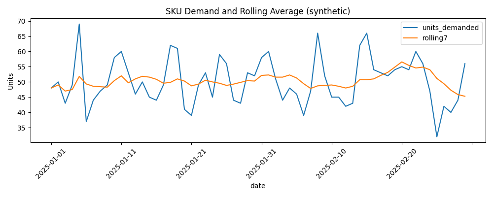

# Supply Chain Inventory & Demand Forecasting

**Portfolio case study | Supply Chain / Operations Analyst Internships**  
**Tools:** Python (pandas, NumPy, Matplotlib), SQL (SQLite), Excel, forecasting, Power BI dashboard design

## Executive summary
Inventory planners need to forecast demand and identify products approaching replenishment thresholds. This project uses **synthetic daily SKU-level records**, evaluates two short-horizon forecasts and flags products below illustrative reorder points.

### Results from synthetic data
- Naive last-observation forecast: **6.33 units mean absolute error (MAE)**.
- Rolling 7-day mean: **4.81 units MAE**, about **24.0% lower** than the naive baseline.
- **10 of 12 SKUs** flagged for replenishment review.

These are simulated results, **not real-world cost savings or measured operational impact**.

## Demand forecast


## Questions addressed
1. Which forecasting method gives lower out-of-sample error?
2. Which SKUs have inventory below a lead-time-informed threshold?
3. How can SQL, Excel and Power BI support replenishment reporting?

## Method
For each SKU, reserve the last 14 days for **rolling one-step-ahead evaluation**, updating the history with actual observations after each prediction. Compare last observed demand with a trailing 7-day mean using MAE. Compute the illustrative reorder point as `ceil(mean training daily demand × lead time × 1.25)`, and flag `on_hand < reorder_point`. The 25% buffer is heuristic, **not** an optimized safety stock policy.

## Files
| File | Purpose |
|---|---|
| `analysis.py` | Reproducible forecasting, replenishment, visualization and SQLite export |
| `data/sample_data.csv` | Synthetic inventory/demand records |
| `sql/analysis.sql` | Inventory analysis queries |
| `outputs/forecast_evaluation.csv` | Per-SKU forecast errors |
| `outputs/sku_replenishment.csv` | Replenishment review flags |
| `outputs/inventory.db` | Generated SQLite database |
| `figures/demand_forecast.png` | Time-series chart |
| `excel_report.xlsx` | Supporting Excel workbook (upload separately if absent) |
| `POWER_BI_GUIDE.md` | Power BI design guidance, not a completed PBIX |

## Run locally
```bash
python3 -m pip install -r requirements.txt
python3 analysis.py
```

Run from the repository root. Python regenerates the output CSVs, SQLite database, and chart.

## Business recommendations
Review flagged SKUs first, then validate supplier lead times, inventory positions, order quantities, holding costs and target service levels before ordering. Future improvements: seasonality, lead-time variability, calibrated safety stock and multi-horizon evaluation.

## Limitations
**All data are synthetic.** Inventory balances are simplified. Rolling one-step forecasts are not fixed 14-day-ahead forecasts. A Power BI report is **planned, not provided**; no `.pbix` file is included.
